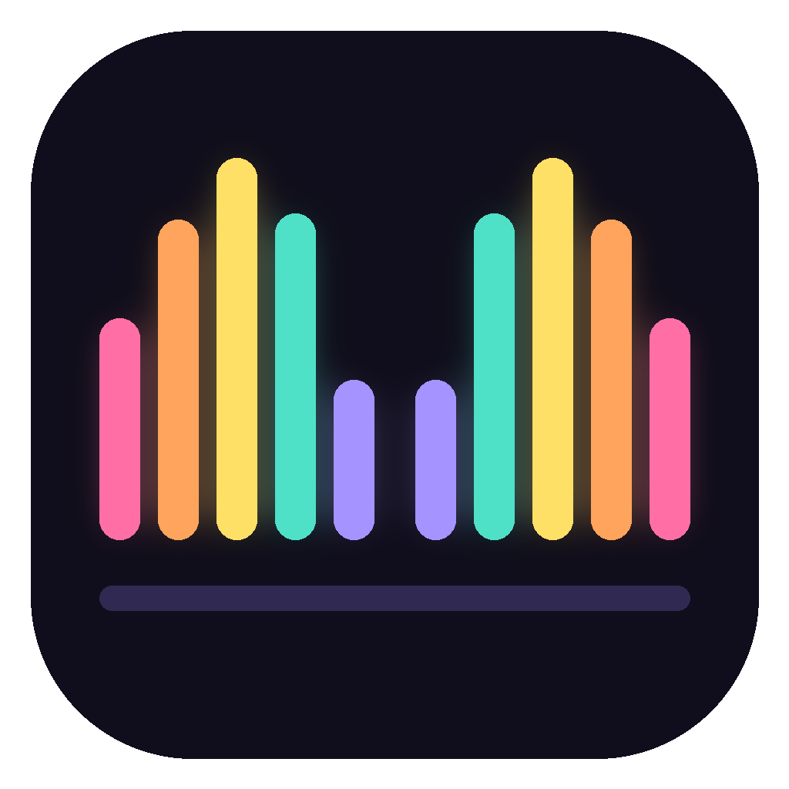

<p align="center"></p>

<h1 align="center">Dix Doigts</h1>

<p align="center">Apprends à taper avec tous tes doigts, sans regarder le clavier.</p>

---

Dix Doigts est une app d'entraînement à la dactylographie. Chaque doigt a sa couleur, le clavier et les deux mains à l'écran montrent quel doigt utiliser pour la prochaine touche, et un compteur indique combien de tes dix doigts ont vraiment travaillé.

## Télécharger

Va dans **[Releases](https://github.com/Tototra/fingertouch/releases/latest)** et prends le fichier de ton système :

| Système | Fichier |
| --- | --- |
| Windows | `DixDoigts-x.y.z-windows-setup.exe` (installateur) ou `-windows-portable.exe` (sans installation) |
| macOS (Intel et Apple Silicon) | `DixDoigts-x.y.z-mac-universal.dmg` |
| Linux | `.AppImage` (toutes distributions) ou `.deb` (Debian, Ubuntu, Mint) |

L'app n'est pas signée par un certificat payant, donc le système va râler au premier lancement :

- **Windows** : « Windows a protégé votre ordinateur » → *Informations complémentaires* → *Exécuter quand même*.
- **macOS** : clic droit sur l'app → *Ouvrir*. Si macOS dit que l'app est endommagée, lance dans le Terminal :
  `xattr -cr "/Applications/Dix Doigts.app"`
- **Linux (AppImage)** : `chmod +x DixDoigts-*.AppImage` puis double-clic.

Une version web tourne aussi sur GitHub Pages une fois activé (voir plus bas).

## Ce que fait l'app

- 7 leçons progressives : rangée de repos, centre, rangée haute, rangée basse, mots courants, phrases avec majuscules, accents et ponctuation.
- Dispositions AZERTY et QWERTY.
- Une faute bloque le curseur jusqu'à la bonne touche.
- Vitesse en mots par minute, précision, doigt le plus fautif, record par leçon.
- Fonctionne hors ligne, les polices sont embarquées.

Raccourcis : `Échap` recommence la leçon, `Entrée` passe à la suivante à la fin.

## Développer

```bash
npm install
npm start          # lance l'app
npm run dist       # construit pour le système courant (dossier dist/)
```

L'interface tient dans un seul fichier : [`app/index.html`](app/index.html). Le processus Electron est dans [`src/main.js`](src/main.js).

## Publier une nouvelle version

1. Change `version` dans `package.json`.
2. Commit, puis crée et pousse un tag :
   ```bash
   git tag v1.0.1
   git push origin main --tags
   ```
3. Le workflow **Build & Release** construit Windows, macOS et Linux sur les runners GitHub et publie la release avec tous les fichiers.

## Version web

Le workflow **Version web (GitHub Pages)** publie le dossier `app/` à chaque push sur `main`. Pour l'activer une fois : *Settings → Pages → Source : GitHub Actions*, puis relance le workflow.

## Licence

MIT. Les polices Bricolage Grotesque et Martian Mono sont sous SIL Open Font License 1.1.
