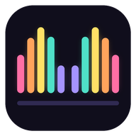

<p align="center"></p>

<h1 align="center">Dix Doigts</h1>

<p align="center">Apprends à taper avec tous tes doigts, sans regarder le clavier.</p>

---

Dix Doigts est un site d'entraînement à la dactylographie. Chaque doigt a sa couleur, le clavier et les deux mains à l'écran montrent quel doigt utiliser pour la prochaine touche, et un compteur indique combien de tes dix doigts ont vraiment travaillé.

- 7 leçons progressives : rangée de repos, centre, rangée haute, rangée basse, mots courants, phrases avec majuscules, accents et ponctuation.
- Dispositions AZERTY et QWERTY.
- Une faute bloque le curseur jusqu'à la bonne touche.
- Vitesse en mots par minute, précision, doigt le plus fautif, record par leçon.
- Tout tourne dans le navigateur. Les records restent en local, rien n'est envoyé.

### Contrôle du doigté

Un clavier ne dit pas quel doigt appuie, alors l'app croise plusieurs indices :

| Contrôle | Ce qu'il vérifie | Fiabilité |
| --- | --- | --- |
| Maj du bon côté | Une lettre de la main gauche doit se faire avec la Maj droite, et inversement. Option bloquante (activée par défaut). | Certaine |
| Chevauchements | Deux touches enfoncées en même temps viennent forcément de deux doigts. Deux touches du même doigt enfoncées ensemble prouvent qu'un autre doigt a pris le relais. | Forte |
| Rythme | À dix doigts, deux lettres du même doigt sont plus lentes que deux lettres de doigts différents. Un rythme sans cette différence trahit peu de doigts. | Indicative |
| Caméra | MediaPipe repère les doigts dans la vidéo et compare le doigt qui descend au doigt attendu. Calibration en 16 touches. La vidéo reste sur l'ordinateur. | Approximative, dépend du cadrage |

Le verdict s'affiche en direct dans la case « Doigté » et en détail à la fin de chaque leçon.

Raccourcis : `Échap` recommence la leçon, `Entrée` passe à la suivante à la fin.

## Structure

C'est un site 100 % statique, sans build ni dépendance.

```
public/
  index.html             toute l'app (HTML, CSS, JS)
  fonts/                 polices embarquées (pas d'appel à Google Fonts)
  vendor/mediapipe/      détection des mains (wasm et modèle ajoutés au déploiement)
  _headers               en-têtes HTTP Cloudflare (sécurité, cache)
  manifest.webmanifest   installable comme app depuis le navigateur
  favicon.ico, icon-*.png, apple-touch-icon.png, og.png
scripts/fetch-vendor.sh  télécharge MediaPipe et le modèle des mains
wrangler.jsonc           config Cloudflare Workers (dossier public/)
```

## En ligne

**https://tototra.github.io/fingertouch/**

Le workflow `.github/workflows/pages.yml` publie le dossier `public/` sur GitHub Pages à chaque push sur `main`.
Activation (une seule fois) : *Settings → Pages → Build and deployment → Source : GitHub Actions*.

Les chemins du site sont relatifs, donc il marche aussi bien dans le sous-dossier `/fingertouch/` de GitHub Pages qu'à la racine d'un domaine Cloudflare.

## Déployer sur Cloudflare (optionnel)

### Option A : Cloudflare Pages (le plus simple)

1. Tableau de bord Cloudflare → **Workers & Pages** → **Create** → onglet **Pages** → **Connect to Git**.
2. Choisis le dépôt `Tototra/fingertouch`.
3. Réglages de build :
   - Framework preset : **None**
   - Build command : `sh scripts/fetch-vendor.sh`
   - Build output directory : `public`
4. **Save and Deploy**. Chaque push sur `main` redéploie le site.

### Option B : Cloudflare Workers (assets statiques)

1. **Workers & Pages** → **Create** → **Import a repository** → `Tototra/fingertouch`.
2. Laisse la commande de déploiement par défaut (`npx wrangler deploy`). Le fichier `wrangler.jsonc` indique déjà de servir le dossier `public/`.

Ou depuis ton ordinateur :

```bash
npx wrangler login
npx wrangler deploy
```

### Domaine perso

Dans le projet Cloudflare → **Custom domains** → ajoute ton domaine. Pense à mettre à jour l'URL de la balise `og:image` dans `public/index.html` avec ton domaine, pour que l'aperçu s'affiche bien quand tu partages le lien.

## Tester en local

```bash
cd public
python3 -m http.server 8000
```

Puis ouvre http://localhost:8000.

## Contribuer

Après un clone, active le hook qui garde les messages de commit propres :

```bash
git config core.hooksPath .githooks
```

## Licence

MIT. Les polices Bricolage Grotesque et Martian Mono sont sous SIL Open Font License 1.1 (`public/fonts/OFL.txt`).
